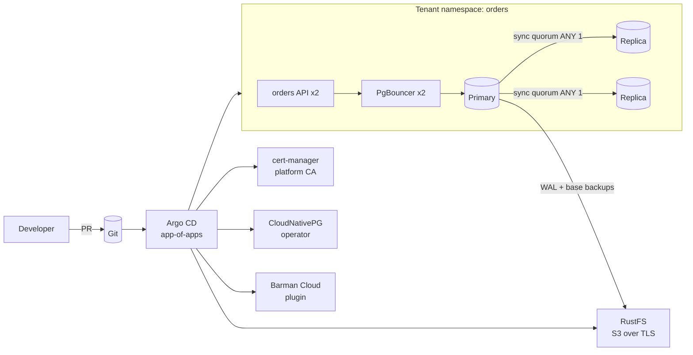

# Keystone: Self-Service PostgreSQL Platform


**An internal developer platform that gives every team a production-ready PostgreSQL database through
GitOps: highly available, zero-data-loss replication, continuous backups, connection pooling, and
failover that is tested continuously, not assumed.**

Most platform demos automate stateless apps. Keystone focuses on the hard part of cloud architecture:
**stateful data, failure recovery and safe change.**

## Self-service: a database in 10 lines

```yaml
apiVersion: platform.keystone.io/v1alpha1
kind: PostgresDatabase
metadata:
  name: orders-db
  namespace: orders
spec:
  environment: prod      # dev = 1 instance, staging = 2, prod = 3 + zero-data-loss replication
  tier: small            # small | medium | large
  databaseName: orders
  owner: team-orders
  costCenter: CC-1001
```

Crossplane turns this into a CloudNativePG cluster, WAL archiving + scheduled backups, TLS trust for the
backup store and a PgBouncer pooler, then reports the **estimated monthly cost** back to the team:

```console
$ kubectl get postgresdatabases -A
NAMESPACE   NAME           ENV    TIER    INSTANCES   COST/MONTH   STATUS                     SYNCED   READY
inventory   inventory-db   dev    small   1           $7.48        Cluster in healthy state   True     True
orders      orders-db      prod   small   3           $21.45       Cluster in healthy state   True     True
```

## Guardrails and FinOps (OPA Gatekeeper, Rego)

| Request | Result |
|---|---|
| Prod database without backups | ⛔ denied |
| Hibernating a prod database | ⛔ denied |
| `large` tier in dev | ⛔ denied |
| Storage above the tier limit | ⛔ denied |
| `environment` that doesn't match the namespace | ⛔ denied |
| **Request whose estimated cost exceeds the namespace's monthly budget** | ⛔ denied (FinOps) |
| Tenant namespace without owner / cost-centre / budget labels | ⛔ denied (FinOps showback) |
| Hand-rolled prod Postgres that bypasses self-service (1 instance, no backups) | ⛔ denied (defence in depth) |
| Idle dev database: `hibernate: true` | ✅ compute cost drops to $0, data kept |

The cost model lives in two places that must agree: the composition reports it, the policy enforces it.
CI renders the composition (`crossplane render`) and asserts the price, and `gator verify` runs 15 policy tests.

## What runs today



| Capability | How |
|---|---|
| GitOps everything | Argo CD app-of-apps with sync waves; CI deploys the exact commit under test |
| HA Postgres | 3 instances on 3 nodes (hard anti-affinity), automated failover by CloudNativePG |
| Zero data loss | Quorum synchronous replication + failover quorum ([ADR 0002](docs/adr/0002-synchronous-quorum-replication.md)) |
| Backups & PITR | Continuous WAL archiving + 6-hourly base backups via Barman Cloud plugin, over TLS ([ADR 0003](docs/adr/0003-backups-object-store.md)) |
| Connection pooling | PgBouncer (transaction mode) so failovers and connection storms never hit Postgres directly |
| No secrets in Git | Credentials generated at bootstrap; on AWS, EKS Pod Identity instead of keys |
| Self-service + FinOps | Crossplane v2 `PostgresDatabase` API with cost showback; Gatekeeper enforces safety rules and per-namespace budgets |
| Cloud-ready | `terraform/aws`: VPC, EKS, Karpenter, encrypted S3 with per-tenant IAM; fmt, validate, tflint and Checkov in CI |

## Proof, on every push

CI creates a 4-node Kubernetes cluster (kind), bootstraps Argo CD, lets GitOps install the whole
platform from the commit under test, then **verifies** it. Each run's Summary page shows a report like:

| Check | Result |
|---|---|
| Cluster ready | ✅ |
| Topology: 3 instances, 1 primary, 3 different nodes | ✅ |
| Zero-data-loss replication: `ANY 1 (...)`, both replicas `quorum` | ✅ |
| Continuous WAL archiving to S3 over TLS | ✅ |
| Base backup completed | ✅ |
| App writes through PgBouncer, served by the primary | ✅ |

## Run it locally (free)

Needs Docker Desktop, [kind](https://kind.sigs.k8s.io/), kubectl, helm and jq.

```bash
make up        # cluster -> app image -> Argo CD -> GitOps -> wait -> verify  (~10 min)
kubectl get applications -n argocd
kubectl -n orders get cluster,pooler,backups
make down
```

## Roadmap

| Phase | Status |
|---|---|
| 1. Foundation: kind, Argo CD app-of-apps, Terraform for EKS | ✅ |
| 2. Stateful core: CloudNativePG, sync replication, backups to S3, PgBouncer, sample app | ✅ |
| 3. Self-service: Crossplane `PostgresDatabase` API (S/M/L tiers), Gatekeeper guardrails, FinOps showback and budgets | ✅ |
| 4. Observability: Prometheus, Grafana, SLOs with burn-rate alerts (Sloth), OpenCost | ⏳ |
| 4b. **AI FinOps advisor**: finds over-provisioned and idle databases from real usage, opens right-sizing / hibernation PRs that the guardrails re-check | ⏳ |
| 5. Safe change: Atlas migration linting, expand/contract, SLO-gated canaries (Argo Rollouts) | ⏳ |
| 6. Resilience proof: chaos failovers under load (RTO/RPO measured), automated restore tests | ⏳ |

## Architecture decisions

- [ADR 0001: CloudNativePG over RDS/Patroni](docs/adr/0001-cloudnativepg-operator.md)
- [ADR 0002: Quorum synchronous replication](docs/adr/0002-synchronous-quorum-replication.md)
- [ADR 0003: Backups to S3-compatible storage](docs/adr/0003-backups-object-store.md)

## Results

<!-- Screenshot of a green CI run and its verification table -->

## What I learned

<!-- In your own words -->
